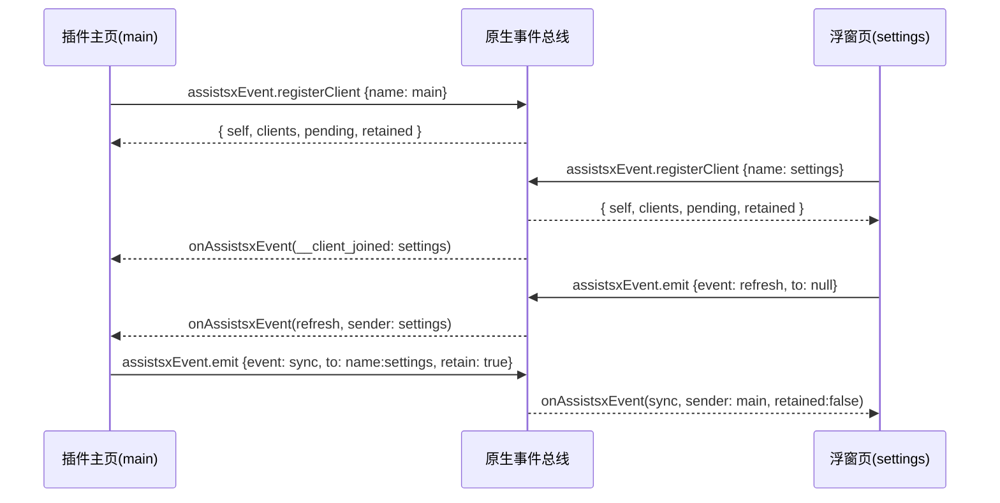

# 跨 WebView 事件总线

一个插件相当于一个 Web 站点，但站点的不同页面可能跑在**互相独立的 WebView** 里：

| 页面 | 宿主 | 说明 |
|------|------|------|
| 插件主页 | `IndexFragment` 内的 WebView | `float.open` 从这里发起 |
| 浮窗页 | `assistsxFloat.open` 创建的浮窗 WebView | 每个浮窗一个独立 WebView，有唯一 `uniqueId` |
| 旧 overlay 页 | `OverlayWeb` 的 WebView | 兼容旧入口 |

这些 WebView 各自是独立的浏览器上下文，**没有共享内存，也不能互相调用函数**。事件总线用于让它们互通：

- 浮窗页里的动作要触发插件主页的逻辑；
- 插件主页的状态要交给**之后才打开的**浮窗页（跨窗口状态同步）；
- 多个浮窗之间联动（一个关掉后刷新另一个）。

## 快速开始

```typescript
import { eventBus } from "assistsx-js";

// ---- 插件主页（entry）----
await eventBus.ready("main");                       // 声明页面名称并完成注册
eventBus.on("refresh", (payload) => {
    console.log("收到浮窗指令", payload);
    reloadList();
});
await eventBus.emit("ready", { at: Date.now() });   // 广播给其他页面

// ---- 浮窗页（/settings.html）----
await eventBus.ready("settings");
await eventBus.emit("refresh", { tab: 2 });                       // 广播（默认不回声给自己）
await eventBus.emit("sync", state, { to: "name:main", retain: true }); // 定向 + 保留
```

> `ready()` 可以省略名称（`await eventBus.ready()`），但声明名称后其他页面才能用 `name:xxx` 定向投递。

## API

### 注册与身份

| 方法 | 说明 |
|------|------|
| `eventBus.ready(name?, timeout?)` | 确保已注册并返回本页身份；传名称时刷新名称（同一 tick 内的多次调用会合并为一次注册） |
| `eventBus.register(name?, timeout?)` | `ready` 的别名 |
| `eventBus.getSelf()` | 本页身份（未注册完成时为 `null`） |
| `eventBus.transport` | 当前通道：`"native"` / `"broadcast"` / `null` |
| `eventBus.available` | 总线是否可用 |
| `eventBus.configure({ broadcastFallback })` | 首次使用前配置（默认 `true`） |

`EventClient` 字段：

| 字段 | 说明 |
|------|------|
| `webViewId` | 原生分配的唯一标识 |
| `name` | 页面声明的名称 |
| `role` | `index`（插件主页）/ `float`（浮窗内）/ `unknown`（浏览器兜底通道无法判定） |
| `uniqueId` | 浮窗唯一标识，与 `float.open` 返回值一致；非浮窗为 `null` |
| `url` / `title` | 页面地址与标题（调试展示用） |
| `scope` | 插件作用域（通常为插件包名），用于跨插件隔离 |
| `ready` | 是否已完成注册握手 |

### 订阅

| 方法 | 说明 |
|------|------|
| `eventBus.on(event, handler)` | 监听事件，返回取消监听的函数；首次调用会自动发起注册 |
| `eventBus.once(event, handler)` | 只监听一次 |
| `eventBus.off(event, handler?)` | 移除监听，不传 handler 时移除该事件全部监听 |
| `eventBus.onClientsChange(handler)` | 监听客户端上下线（不含自身） |
| `eventBus.getClients()` | 当前已知客户端（含自身），本地缓存 |
| `eventBus.refreshClients(timeout?)` | 主动拉取一次客户端列表 |

```typescript
eventBus.on<{ tab: number }>("refresh", (payload, message) => {
    console.log(message.sender.name, payload.tab, message.retained);
});
```

`EventMessage` 字段：`event` / `payload` / `sender{webViewId,name,role,uniqueId}` / `messageId` / `ts` / `retained` / `scope`。

### 发送

```typescript
const result = await eventBus.emit("cmd", { action: "close" }, { to: "role:float" });
// result = { messageId, delivered: ["<webViewId>"], missed: [] }
```

| 选项 | 默认 | 说明 |
|------|------|------|
| `to` | `"all"` | 目标选择器，见下表 |
| `retain` | `false` | 保留最后一条，供后续注册的页面回放 |
| `excludeSelf` | `true` | 仅对广播生效；`to: "self"` 时强制投递给自身 |
| `timeout` | 30 秒 | 等待原生回执的超时 |

| 选择器 | 含义 |
|--------|------|
| `"all"` | 同作用域的其他页面 |
| `"self"` | 仅本页 |
| `"role:float"` | 所有浮窗内页面 |
| `"name:main"` | 声明了该名称的页面（可命中多个） |
| `"<webViewId>"` | 指定页面 |
| `"<uniqueId>"` | 指定浮窗（`float.open` 的返回值） |
| `{ webViewId?, uniqueId?, name?, role? }` | 对象选择器，多字段为与关系 |

### 保存

```typescript
await eventBus.emit("sync", state, { retain: true });   // 保留最后一条
const list = await eventBus.getRetained("sync");        // 主动查询
await eventBus.clearRetained("sync");                   // 清空
```

新页面注册时，保留消息会随注册响应在**处理器就位之后**回放（`retained: true`），因此适合「主题/语言/当前选中项」这类状态同步。

## 寻址：怎么知道发给哪个 WebView

| 办法 | 适用 |
|------|------|
| `float.open` 返回的 `uniqueId` | **开窗那一刻就知道**；目标页面还没加载完也能投递（原生会排队补发） |
| `eventBus.getClients()` | 运行时查询在线页面（`name` / `role` / `uniqueId` / `ready`），配合 `onClientsChange` 实时跟踪 |
| `message.sender` | **谁问我我就回谁**：`{ to: message.sender.webViewId }`，无需事先知道对方是谁 |

```typescript
// ① 开窗即定向
const uniqueId = await float.open('/examples/event-panel');
await eventBus.emit('load-config', cfg, { to: uniqueId });

// ② 运行时选目标
const floatClients = eventBus.getClients().filter((c) => c.role === 'float');

// ③ 回给发起方
eventBus.on('ask-config', (_p, m) => eventBus.emit('config', cfg, { to: m.sender.webViewId }));
```

## 只听指定 WebView 的事件

`on()` 不区分来源，过滤写在处理器里（每条消息都带 `message.sender`）：

```typescript
eventBus.on('task-done', (payload, message) => {
    if (message.sender.name !== 'settings') return;    // 只看 settings 发的
    // if (message.sender.role !== 'float') return;    // 只看浮窗发的
    refresh(payload);
});
```

## 可靠性约定

1. **默认不回声**：`emit` 不会触发本页的处理器；需要本页也响应时用 `to: "self"`。
2. **目标页面还在加载**：消息进入原生待投递队列（≤50 条 / 30 秒），该页面注册完成后随响应一次性补发。
3. **目标不存在或已销毁**：`emit` 的 `missed` 会列出这些目标，可据此重试或先把页面打开。
4. **保留回放顺序**：注册响应中依次为「保留消息 → 待投递消息 → 注册完成前收到的推送」。
5. **payload 限制**：必须可 JSON 序列化，且不超过 64KB（超出会返回错误）。大对象（截图、长列表）请走 `db` / 文件系统，事件里只传引用键。
6. **未注册的处理器不会收到消息**：事件总线不做无界缓存。需要「随时都可能到达」的状态请用 `retain: true`，或在应用入口尽早 `ready()` + `on()`。

## 两条传输通道

| 通道 | 何时使用 | 能力 |
|------|----------|------|
| `native`（`window.assistsxEvent`） | AssistsX 宿主（开源版 / 平台版） | 全能力：精确定向、待投递队列、保留回放、`missed` 回执、按插件隔离 |
| `broadcast`（`BroadcastChannel`） | 浏览器 `npm run dev` 联调、旧宿主、非 `XWebview` 宿主 | **仅同源**、无待投递队列、定向由接收端过滤、保留消息仅由在线页面补发一次 |

原生通道可用时，SDK 仍会监听同源广播作为兜底接收端（`configure({ broadcastFallback: false })` 可关闭），并按 `messageId` 去重，避免「一侧走原生、一侧走广播」造成的单向静默失败。

## 时序



## 常见坑

| 现象 | 原因 | 解决 |
|------|------|------|
| `eventBus.transport` 为 `"broadcast"` | 宿主未注入 `assistsxEvent`（旧版本宿主 / 非 `XWebview` 宿主） | 升级宿主；或仅在该环境下做同源联调 |
| 页面收不到消息 | 没有调用 `ready()` / `on()`，页面尚未注册 | 在应用入口 `await eventBus.ready("main")` |
| 定向 `name:xxx` 报 `missed` | 目标页面未声明该名称，或尚未加载完 | 用 `float.open` 返回的 `uniqueId` 定向，或确认目标已 `ready("xxx")` |
| 本页没触发自己的广播 | `excludeSelf` 默认 `true` | 用 `to: "self"`，或显式 `excludeSelf: false` |
| 消息偶尔丢 | 走的是广播通道（浏览器兜底） | 同上：正式环境应由原生通道承载 |
| 切换插件后收到旧消息 | 未按插件隔离（广播通道不具备该能力） | 原生通道按运行插件作用域隔离，避免依赖广播通道做跨插件通信 |
| `payload 过大` 报错 | 超过 64KB 上限 | 大对象写入 `db` / 文件系统，事件只传键 |

## 与 mmkv / db 的分工

| 需求 | 推荐 |
|------|------|
| 跨页面**实时**通知（谁触发了谁、状态变了要刷新） | 事件总线 |
| 跨页面+跨启动**持久**数据 | `mmkv` / `db`（可用事件通知变更） |
| 需要「新页面打开时自动拿到最新状态」 | `emit(..., { retain: true })` |

## 扩展阅读

- [bridge-and-call-response.md](./bridge-and-call-response.md)
- [utils-and-bridge-reference.md](./utils-and-bridge-reference.md)
- [float-and-ui.md](../03-modules/float-and-ui.md)
